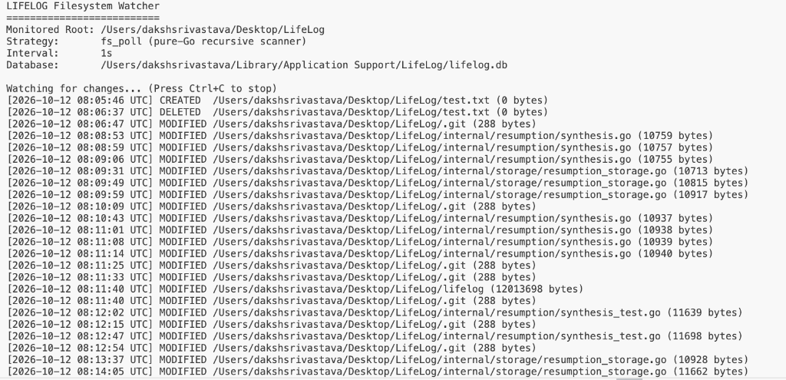
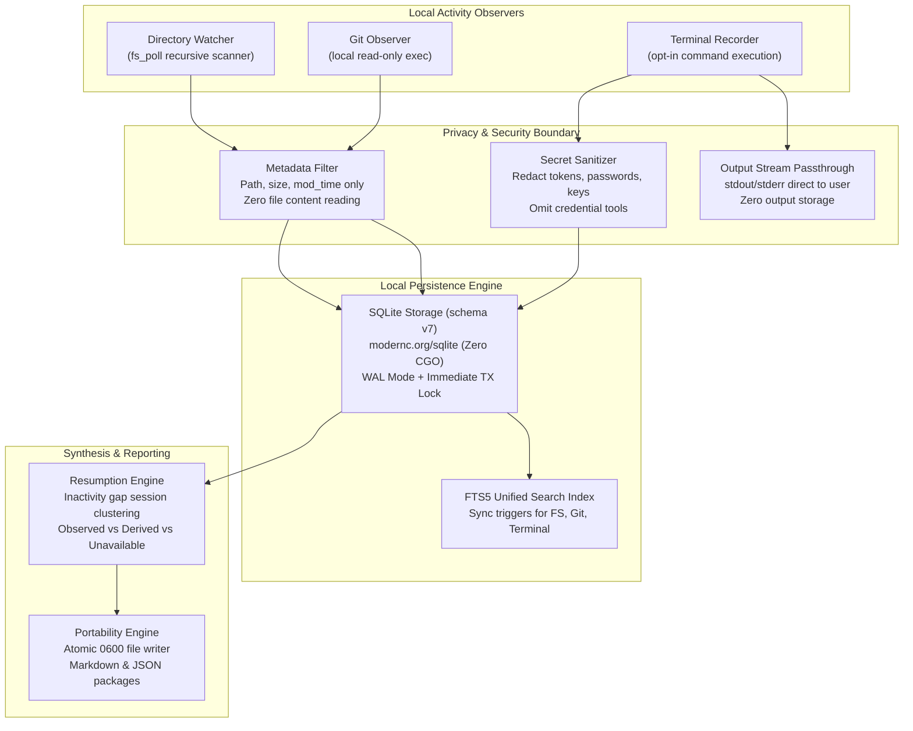
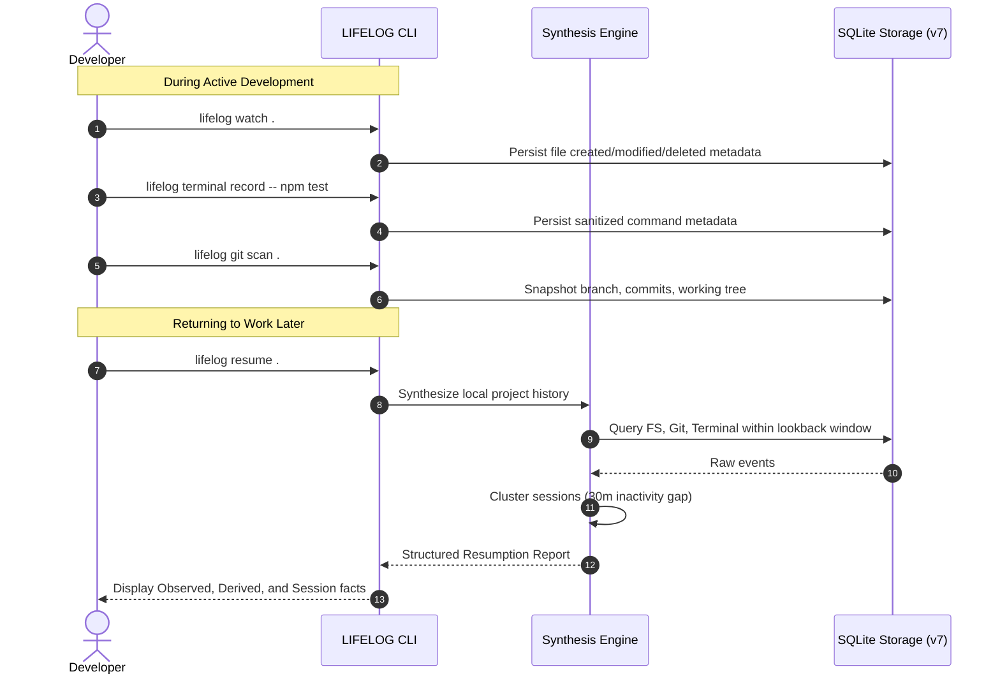

# LIFELOG

Local-First Computer Memory Engine for macOS. Pick Up Exactly Where You Left Off.

[](go.mod)
[-lightgrey)](README.md)
[-success)](README.md)
[](LICENSE)
[](internal/storage/storage.go)

---

## Overview

Software engineers switch tasks, attend meetings, and context-switch across projects daily. Reconstructing mental context when returning to a project takes valuable time:

- Which files were modified before stopping?
- Which Git branch and commits were active?
- What commands were run in the terminal?
- What was the last logical work session?

LIFELOG is a lightweight, local-first computer memory engine built for macOS that automatically connects filesystem modifications, local Git state, explicitly recorded terminal executions, and activity session clustering into deterministic project resumption reports.

All data remains 100% on your local machine. LIFELOG never uploads anything to the cloud, never tracks telemetry, and never reads the contents of your files.

---

## Live Demonstration

The screenshot below illustrates the pure-Go recursive filesystem watcher detecting file creations, modifications, and deletions in real time with exact byte sizes and UTC timestamps:



---

## Architectural Workflow

LIFELOG operates on a strictly partitioned, unidirectional architecture. Data flows through a privacy sanitization boundary before reaching encrypted/restricted local SQLite storage:



---

## Core Principles

- **Local-First & Zero Telemetry**: All database records, indexes, and logs reside solely on the user machine in `~/Library/Application Support/LifeLog`. No remote servers, analytics, or background telemetry.
- **Pure Go / Zero CGO**: Built with `modernc.org/sqlite` and pure-Go directory polling. Compiles with `CGO_ENABLED=0` without requiring Xcode toolchains or Apple CoreServices C bindings.
- **Zero Content Snooping**: Filesystem observation records file metadata only (path, size, timestamp, event type). File contents, patches, and code diffs are never inspected or persisted.
- **Zero Command Output Scraping**: Terminal recording captures execution metadata (command line, duration, exit status, directory). Standard output, standard error, and shell history files are never recorded.
- **Deterministic Secret Redaction**: Sensitive flags (`--password`, `--token`, `--api-key`), auth headers, inline credentials, and sensitive authentication utilities (`security`, `op`, `pass`, `vault`, `ssh-add`) are automatically sanitized into `[REDACTED]` or `[DETAILS OMITTED]`.
- **Protected File Boundaries**: Data directories use `0700` permissions. SQLite databases, config files, and exported bundles use `0600` permissions. Export destinations within the internal data directory are rejected.

---

## Daily Resumption Lifecycle



---

## Prerequisites

- macOS 12.0+ (Apple Silicon `darwin/arm64` or Intel `darwin/amd64`)
- Go 1.22 or higher (verified on Go 1.27.2)
- Git 2.20+

---

## Installation & Setup

### 1. Build from Source

```bash
git clone https://github.com/Daksh-create349/LifeLog-Pick-up-where-you-left-off.git
cd LifeLog-Pick-up-where-you-left-off
go build -o lifelog .
```

### 2. Initialize Application Storage

Initializes directory layout (`0700`), default configuration (`0600`), and SQLite schema v7 (`0600`):

```bash
./lifelog init
```

### 3. Verify Health Diagnostics

Runs non-destructive integrity checks verifying permissions, path resolution, and SQLite database integrity:

```bash
./lifelog doctor
```

```text
LIFELOG Doctor Diagnostics
==========================
[PASS] Platform Compatibility       macOS (arm64)
[PASS] Path Resolution              Data directory: /Users/.../Application Support/LifeLog
[PASS] Data Directory               Exists with secure permissions (0700)
[PASS] Configuration File           Valid (version 1)
[PASS] Database File Permissions    Secure permissions (0600)
[PASS] Database Integrity           Integrity OK (schema version 7)

Summary: 6 passed, 0 warning(s), 0 failure(s)
```

---

## Feature Tour & CLI Usage

### 1. Project Resumption (`resume`)

Synthesizes an evidence-based report combining recorded filesystem events, local Git state, and terminal executions for a project directory:

```bash
# Resume project at current working directory
./lifelog resume .

# Resume specific project with custom window and session gap
./lifelog resume /path/to/project --window 24h --gap 15m --limit 50
```

#### Real Resumption Output:

```text
================================================================================
LIFELOG PROJECT RESUMPTION REPORT
================================================================================
Target Path:    .
Canonical Path: /Users/dakshsrivastava/Desktop/LifeLog
Last Activity:  2026-10-12 08:14:38 UTC (0s ago)
Time Window:    Since 2026-10-05 08:14:43 UTC (inactivity gap threshold: 30m0s)

--------------------------------------------------------------------------------
1. OBSERVED ACTIVITY (Persisted Local Facts)
--------------------------------------------------------------------------------

[Filesystem Activity]
  Total Events: 29 (Created: 1, Modified: 27, Deleted: 1)
  Recently Changed Paths:
    modified  internal/storage/resumption_storage.go    (3 event(s), last: 2026-10-12 08:14:18)
    modified  internal/resumption/synthesis.go          (4 event(s), last: 2026-10-12 08:11:13)
    deleted   test.txt                                  (2 event(s), last: 2026-10-12 08:06:37)

[Git Repository Memory]
  Repository:   /Users/dakshsrivastava/Desktop/LifeLog [repo_bf89e902c6e174e9]
  Branch:       main
  Working Tree: 8 uncommitted change(s):
    untracked   .gitignore
    untracked   README.md
    untracked   context.md
    untracked   go.mod

[Terminal Execution Records]
  Explicitly Recorded Commands: 1
    2026-10-12 08:07:01  exit=0    2ms       echo "hello world" --token=[REDACTED]

--------------------------------------------------------------------------------
2. DERIVED ACTIVITY SESSIONS & SYNTHESIS (Computed Context)
--------------------------------------------------------------------------------

[Context Inference]
  Recent recorded activity suggests work involving filesystem modifications in
  internal/resumption (6 events), branch "main", terminal execution across 1 session(s).

[Chronological Activity Sessions]
  session-001 (2026-10-12 08:07:01 -> 08:14:38, duration: 7m, 21 events)
    Summary: 20 file event(s), 1 terminal command(s) [ran "echo \"hello world\" --token=..."]

--------------------------------------------------------------------------------
3. UNAVAILABLE CONTEXT & PRIVACY BOUNDARIES
--------------------------------------------------------------------------------

  - File contents and source code diffs are not indexed or inspected (privacy boundary).
  - Terminal standard output, standard error, and shell history are never captured (privacy boundary).
  - Git remote URLs, credentials, and network repositories are not collected (privacy boundary).
================================================================================
```

---

### 2. Filesystem Observation (`watch` & `events`)

Monitors an explicit project root for additions, modifications, and deletions using periodic recursive snapshot scanning:

```bash
# Monitor directory with default 1s interval (Ctrl+C to stop)
./lifelog watch .

# Monitor with custom interval
./lifelog watch /path/to/project --interval 500ms
```

Query recorded events in deterministic reverse-chronological order:

```bash
# Query latest 20 events
./lifelog events

# Filter by directory path and limit
./lifelog events --path /path/to/project/src --limit 50
```

---

### 3. Git Repository Memory (`git scan`, `repos`, `status`, `log`)

Registers and monitors local Git repositories without network access:

```bash
# Register and scan repository
./lifelog git scan .

# List all registered repositories
./lifelog repos

# Inspect observed working-tree changes
./lifelog git status .

# Query recorded commit history
./lifelog git log . --limit 20

# View branch movements over time
./lifelog git branches .
```

---

### 4. Privacy-First Terminal Memory (`terminal`)

Executes commands, streams output directly to your screen, masks secrets, and records execution metadata:

```bash
# Direct execution (default, arguments passed directly without shell)
./lifelog terminal record -- npm test

# Direct execution with sensitive flags (automatically redacted)
./lifelog terminal record -- curl -H "Authorization: Bearer token123" https://api.local

# Explicit shell invocation mode
./lifelog terminal record --shell -- "make build && ./run.sh"

# Inspect terminal execution history
./lifelog terminal history --limit 20

# Inspect specific record details
./lifelog terminal inspect term_1791792421725917000_0001
```

---

### 5. Unified Full-Text Search (`search` & `timeline`)

Search across filesystem metadata, Git commit subjects, branch names, and sanitized terminal commands using SQLite FTS5:

```bash
# Cross-domain full-text search
./lifelog search "migration"

# Filter by domain (filesystem, git, terminal)
./lifelog search --domain git "auth service"

# Search with time constraints
./lifelog search "deploy" --since 24h --limit 10

# Unified chronological activity timeline
./lifelog timeline --limit 50
```

---

### 6. Portable Context Packages & Checkpoints (`package`, `checkpoint`, `export`)

Preserve or export your project resumption state:

```bash
# Package complete project context into a portable Markdown document
./lifelog package . -o project-context.md

# Package into structured JSON for automated tooling
./lifelog package . --format json -o context.json

# Save an explicit, named historical checkpoint before major changes
./lifelog checkpoint create . --label "Before database migration"

# List saved checkpoints for a project
./lifelog checkpoint list .

# View a historical checkpoint snapshot
./lifelog checkpoint show chk_1791786788864174000_e649a4f3
```

---

### 7. Multi-Project Overview (`projects`)

Provides a unified overview of all known projects discovered across Git records, checkpoints, terminal history, and filesystem activity:

```bash
# View all known projects sorted by recent activity
./lifelog projects

# Sort by project name or total activity count
./lifelog projects --sort name
./lifelog projects --sort activity

# Output as JSON
./lifelog projects --json
```

---

## Performance Benchmarks

Audited on Apple M4 (macOS 15, `darwin/arm64`):

| Operation | Scale / Dataset | Latency | Memory / Allocs | Throughput |
| :--- | :--- | :---: | :---: | :---: |
| **Directory Scan (`fs_poll`)** | 510 items recursive | **1.16 ms/op** | 511 KB / 3,731 allocs | ~860 scans/sec |
| **FTS5 Unified Search** | Cross-domain indexed tables | **74.9 µs/op** | 1.9 KB / 51 allocs | ~13,350 queries/sec |
| **Multi-Project Discovery** | All recorded domain tables | **466.7 µs/op** | 102 KB / 1,959 allocs | ~2,140 ops/sec |

---

## Database Schema (v7)

The local SQLite database uses WAL mode (`_journal_mode=WAL&_synchronous=NORMAL&_txlock=immediate`) and is managed via forward-only schema migrations:

1. `v1_initial_schema`: `schema_migrations`, `metadata`
2. `v2_git_schema`: `filesystem_events` table and indices
3. `v3_git_memory_tables`: `git_repositories`, `git_commits`, `git_snapshots`, `git_working_tree_changes`, `git_branches`, `git_branch_log`
4. `v4_terminal_records`: `terminal_records` table and indices
5. `v5_search_index_fts5`: FTS5 `search_index` table and synchronization triggers
6. `v6_checkpoints`: `checkpoints` table with path index
7. `v7_fix_search_delete_triggers`: Cascade cleanup triggers for deleted Git repositories, commits, branches, and logs

---

## Security and Privacy Model

| Aspect | Guarantee | Enforcement |
| :--- | :--- | :--- |
| **File Contents** | Never read or persisted | Filesystem poller reads `os.FileInfo` metadata only. File content read calls are prohibited. |
| **Terminal Output** | Never collected or stored | Output streams directly via `io.Writer` passthrough. `terminal_records` table contains zero output fields. |
| **Network & Telemetry** | Zero external traffic | Codebase contains zero networking packages for telemetry or sync. Git commands run strictly locally without remote URLs. |
| **Credentials & Secrets** | Sanitized before write | Token patterns (`ghp_...`, AWS keys, bearer tokens) and passwords are masked with `[REDACTED]`. Tools like `security`, `op`, `pass`, `vault` are omitted. |
| **File Permissions** | Owner-only access | Directories created with `0700`. Database, configuration, and exported files created with `0600`. |
| **Destination Isolation** | Protected application directory | Resumption packages and exports reject output paths located inside `$LIFELOG_DATA_DIR`. |

---

## Community and Contributing

- **License**: [MIT License](LICENSE)
- **Contributing**: See [CONTRIBUTING.md](CONTRIBUTING.md) for architecture guidelines, code standards, and verification steps.
- **Code of Conduct**: See [CODE_OF_CONDUCT.md](CODE_OF_CONDUCT.md) for community participation guidelines.

---

## Repository Structure

```text
.
├── LICENSE                     # MIT License
├── CONTRIBUTING.md             # Contribution guidelines
├── CODE_OF_CONDUCT.md          # Community code of conduct
├── README.md                   # Comprehensive project documentation
├── context.md                  # Authoritative architectural state of truth
├── go.mod                      # Module definition (github.com/lifelog/lifelog)
├── go.sum                      # Dependency checksums
├── main.go                     # Application entry point
├── main_test.go                # Subprocess integration & binary acceptance suite
├── docs/
│   └── images/
│       └── watcher-demo.png    # Live filesystem watcher demonstration screenshot
└── internal/
    ├── cli/                    # 17 CLI subcommands and flag handlers
    ├── collector/              # Pure-Go recursive directory poller (fs_poll)
    ├── config/                 # Typed config loader, atomic saver, validation
    ├── events/                 # Filesystem event models and validation
    ├── git/                    # Safe read-only Git observer and worktree parser
    ├── paths/                  # macOS Application Support and symlink resolver
    ├── resumption/             # Context synthesis, session clustering, package exporter
    ├── search/                 # FTS query parser, sanitizer, explainable scoring
    ├── storage/                # SQLite connection manager, WAL mode, migrations v1-v7
    └── terminal/               # Subprocess execution and secret redaction engine
```
